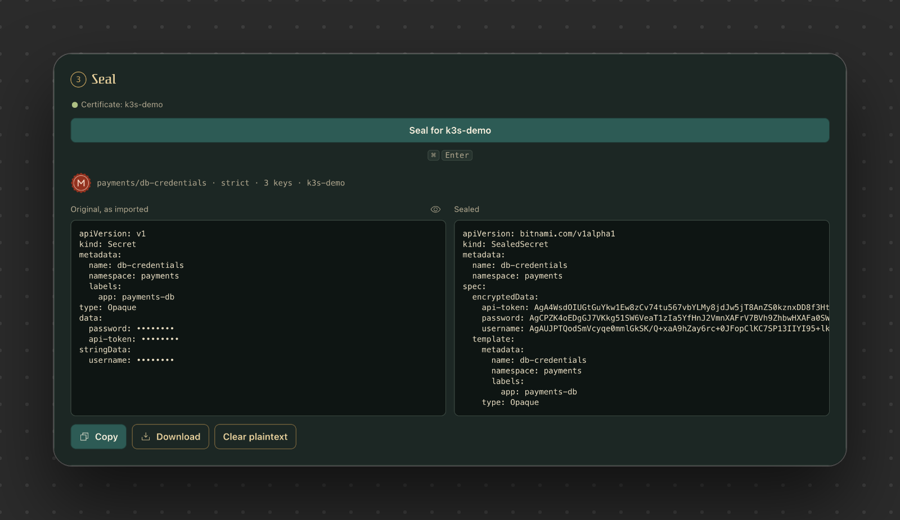
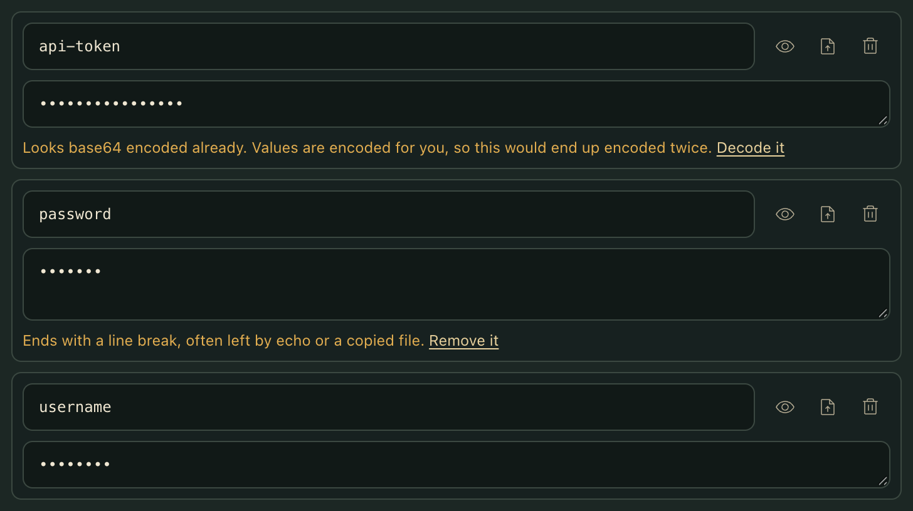
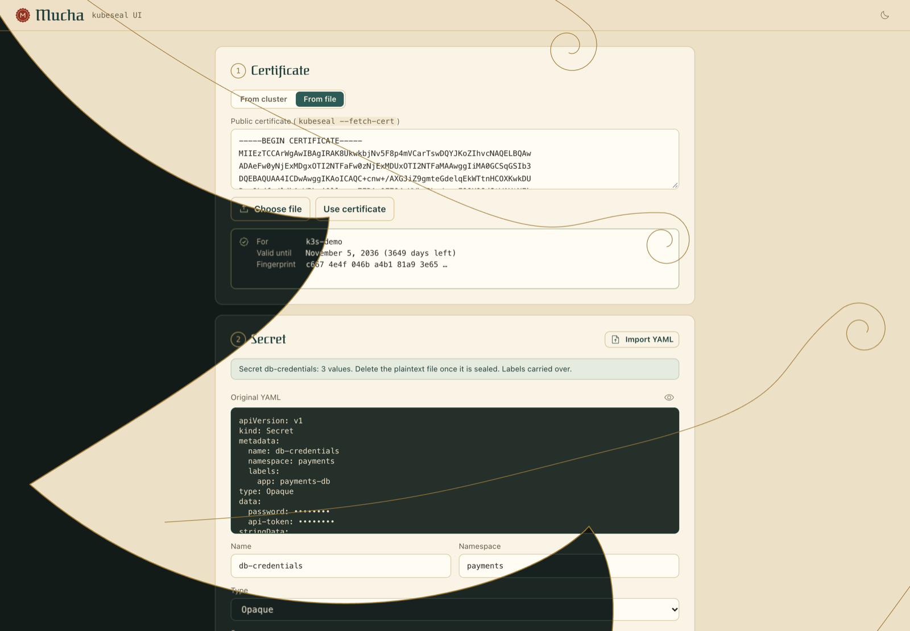
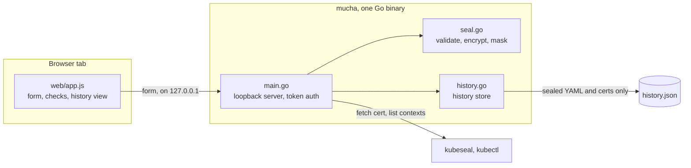

# Mucha

<p align="center"><a href="https://preacherxp.github.io/30-days-of-tools/"></a></p>

<p align="center"><a href="https://buymeacoffee.com/michal.hachula"></a></p>

A local web UI for [Sealed Secrets](https://github.com/bitnami-labs/sealed-secrets) that catches the usual `kubeseal` mistakes before they are encrypted and you can no longer see them.

You run one binary and a page opens on your machine. Pick a cluster or a certificate, then type a secret or import its YAML. Mucha flags a trailing newline from `echo`, a value that is already base64 encoded, a bad name or a missing key, each with a one-click fix where one exists. The button says which cluster you are sealing for, and you copy the SealedSecret when the checks are clear. No server, no account, and plaintext never touches the disk.

<p align="center"></p>

## Requirements

- macOS. It also builds for Linux and Windows, but neither has been run yet.
- A current Chromium browser to use it. Firefox and Safari are untested.
- [`kubeseal`](https://github.com/bitnami-labs/sealed-secrets#kubeseal) and `kubectl` on `PATH` to fetch certificates from a cluster. Without them, load a certificate file instead. Tested with kubeseal 0.30.0 and the 0.30.0 controller on k3s 1.31.
- Go 1.24 or later to build it.

## Install

```sh
go install github.com/preacherxp/mucha@latest
```

This puts `mucha` in `$(go env GOPATH)/bin`. Or from source:

```sh
git clone https://github.com/preacherxp/mucha.git
cd mucha
go build -o mucha .
```

To update, run `go install` again. To uninstall, delete the binary and its history: `rm "$(go env GOPATH)/bin/mucha"`, then remove `~/Library/Application Support/mucha` on macOS or `~/.config/mucha` on Linux.

## Usage

```sh
mucha                            # start it and open the browser
mucha --no-open                  # only print the URL
mucha --addr 127.0.0.1:8080      # pick the port; keep it on loopback
mucha --history ./history.json   # keep history somewhere else
```

The page works top to bottom, and stops the **Seal** button until every blocking check passes.

| Key | Action |
| --- | --- |
| `⌘ Enter` or `Ctrl Enter` | Seal |
| `←` `→` on the tabs | Switch between **From cluster** and **From file** |

- **Certificate.** **From cluster** runs `kubeseal --fetch-cert` for the context you pick. **From file** takes a PEM. Switching context drops the old certificate, so the button always names the certificate in use.
- **Secret.** Type keys and values, load a value from a file, or use **Import YAML** with a `Secret` or a `SealedSecret`. Values are encoded for you and masked until you reveal them.
- **Scope.** `strict`, `namespace-wide` or `cluster-wide`, each showing what it binds to, such as `payments/db-credentials`.
- **Editing a SealedSecret.** Import it to add keys or replace single values, like `kubeseal --merge-into`. The fields its existing values depend on are locked, so they keep decrypting.
- **Seal.** After an import, the original and the sealed YAML sit side by side. Any later edit greys out the result and disables **Copy** until you seal again.
- **History.** Every seal and certificate is kept across runs. **Open** brings a seal back with the certificate it used, and **Use** reloads a certificate.

<p align="center"><br><sub>What a real import of a slightly wrong Secret looks like.</sub></p>

What it checks before sealing:

| Mistake | What you get |
| --- | --- |
| Trailing newline, stray spaces | Warning with **Remove it** or **Trim** |
| Value already base64 encoded | Warning with **Decode it** |
| Bad name, namespace or key, duplicate key, empty value | Blocks sealing |
| Required key missing for `tls`, `dockerconfigjson` or `ssh-auth`, or invalid docker JSON | Blocks sealing |
| Over the 1 MiB secret limit, or an expired certificate | Blocks sealing |
| Namespace not found in the cluster | Warning |

Nothing leaves your machine. The page talks only to the local process, on `127.0.0.1` behind a one-time token, and values stay in the browser tab until you reload or press **Clear plaintext**. History is written to `history.json` in your user config directory (`~/Library/Application Support/mucha/` on macOS), mode 0600. It holds sealed YAML, public certificates, and secret, key and context names, but never values.

The theme toggle follows your system until you press it. It changes theme by opening a flower across the page, because the project is named after [Alphonse Mucha](https://en.wikipedia.org/wiki/Alphonse_Mucha). With reduced motion on, it switches instantly.

<p align="center"></p>

### Try it without a cluster

The repo has a throwaway secret with two deliberate mistakes. Make yourself a key pair, load `test-cert.pem` in **From file**, and import `test-secret.yaml`:

```sh
openssl req -x509 -newkey rsa:4096 -nodes -keyout testdata/test-key.pem -out testdata/test-cert.pem -days 365 -subj "/CN=sealed-secret"
kubeseal --recovery-unseal --recovery-private-key testdata/test-key.pem -o yaml < db-credentials.sealed.yaml
```

The second command decrypts what you downloaded, so you can see the fixes landed. Both key files are ignored by git.

## Limits

- It doesn't apply anything to a cluster. You commit or `kubectl apply` the YAML yourself.
- It can't decrypt existing values. Sealed values are kept or replaced, never shown.
- Files with more than one YAML document are rejected. Import one at a time.
- Empty values block sealing, although Kubernetes allows them. Give the key a value or remove it.
- A certificate from history is only checked for expiry. The controller creates a new key about every 30 days while certificates stay valid for years, so fetch a fresh one when it matters.
- A certificate fetched automatically on page load shows up in history after your next action.
- There are no prebuilt binaries yet.

## Architecture



- **`main.go`** serves the embedded page and a small API. Every API call needs the token from the URL and rejects other origins, so another site open in your browser can't reach it.
- **`seal.go`** encrypts in process with the same scheme as sealed-secrets (RSA-OAEP with SHA-256 wrapping a one-time AES-256-GCM key, labelled by scope). That keeps sealing instant and avoids passing plaintext through another process. It also masks an imported Secret by allowing only identifying fields through, because comments and `last-applied-configuration` can hold plaintext.
- **`history.go`** rereads the file on each change and replaces it atomically. A file it can't parse is reported and left alone, and sealing keeps working.
- **`web/`** is plain HTML, CSS and JavaScript with no build step, embedded in the binary. The page stays hidden until its font and first data arrive, so opening or refreshing it causes no layout shift.

## Development

```sh
go test ./...                             # sealing, import, masking and history
go build -o mucha .                       # the binary, with web/ embedded
node scripts/gen-bloom.mjs > web/bloom.svg     # the theme flower
node scripts/gen-seal.mjs > web/favicon.svg    # the wax seal
```

One test seals with Mucha and decrypts with the real `kubeseal --recovery-unseal` for all three scopes. It is skipped if `kubeseal` isn't installed. The files in `web/` are embedded, so rebuild to see a change in them.

## License

[MIT](LICENSE). The Federant typeface in `web/` is by Cyreal, under the [SIL Open Font License](web/OFL.txt). Icons are from [Phosphor](https://phosphoricons.com) (MIT).

<sub>If it saves you from debugging one more trailing newline, you can [buy me a coffee](https://buymeacoffee.com/michal.hachula).</sub>
